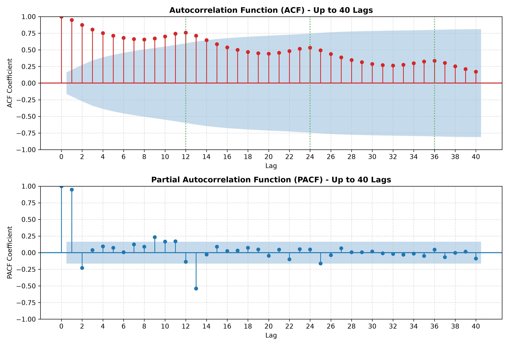
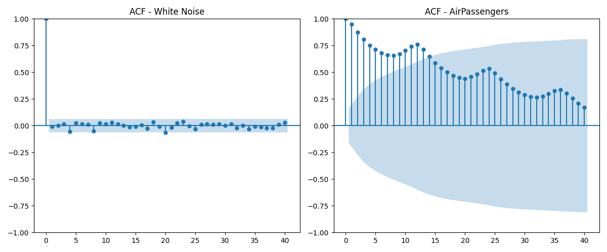
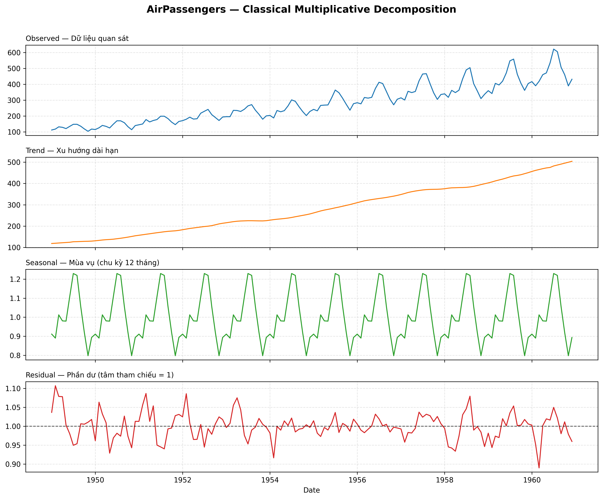
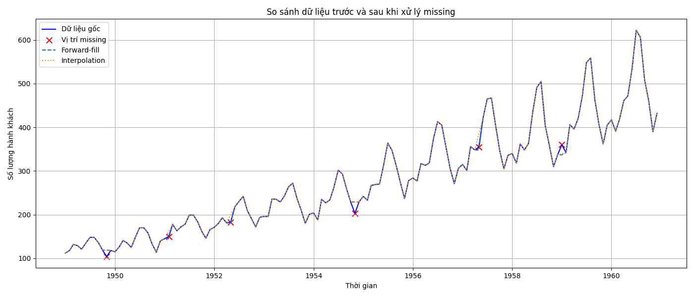
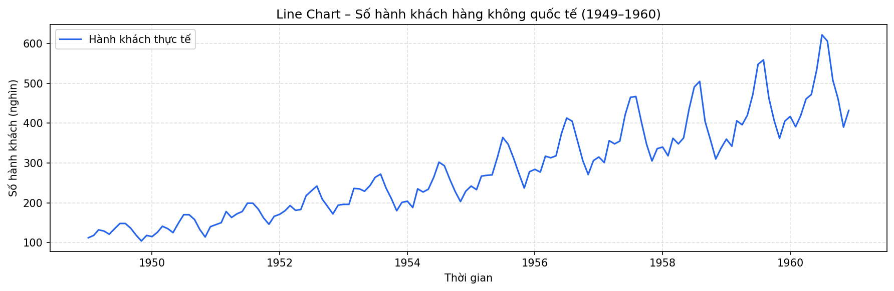
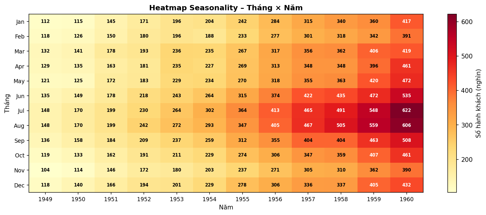
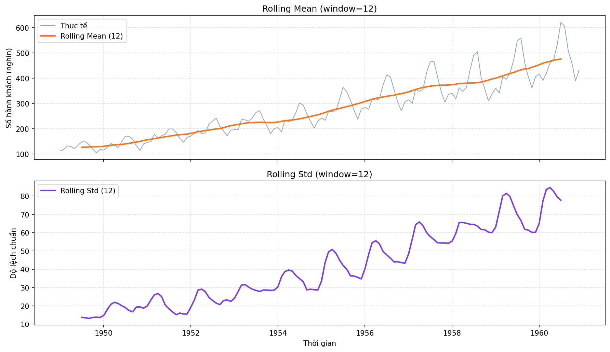
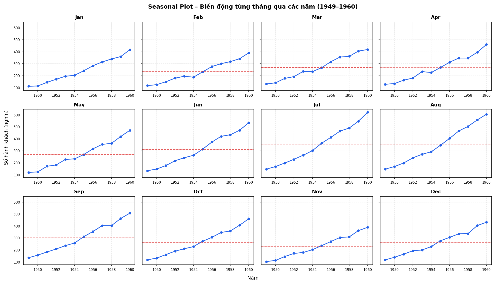

# Task 6: Báo cáo tổng hợp dự án phân tích chuỗi thời gian AirPassengers

---

## 1. Tổng quan dự án

- **Dataset:** `AirPassengers.csv` (Dữ liệu số lượng hành khách hàng không quốc tế hàng tháng từ 01/1949 đến 12/1960 — 144 quan sát).
- **Mục tiêu:** Khảo sát toàn diện đặc trưng chuỗi thời gian thông qua các góc nhìn: Kiểm tra chất lượng dữ liệu, đánh giá tính ngẫu nhiên (White Noise), phân tích hàm tự tương quan (ACF/PACF), phân rã các thành phần (Decomposition), trực quan hóa đa chiều và đánh giá tiềm năng xây dựng mô hình dự báo.

---

## 2. Tổng hợp kết quả từ các Task nghiên cứu

### 2.1. Task 1: Phân tích hàm tự tương quan (ACF & PACF)
*(Chi tiết tại [task1_report.md](task1_report.md))*

- **Hiện tượng suy giảm chậm (Slow Decay) của ACF:** Toàn bộ hệ số ACF từ lag 1 đến lag 40 đều mang giá trị dương rất cao (bắt đầu từ **0.9480** ở lag 1 và vẫn còn **0.3370** ở lag 40), vượt xa khỏi dải tin cậy 95%. Đây là dấu hiệu đặc trưng của chuỗi thời gian có xu hướng tăng dài hạn mạnh mẽ và **không dừng (non-stationary)**.
- **Tính chu kỳ mùa vụ:** Biểu đồ ACF xuất hiện các đỉnh sóng lặp lại rõ rệt tại các bội số của 12 (**Lag 12 = 0.7604, Lag 24 = 0.5322, Lag 36 = 0.3370**), khẳng định chu kỳ mùa vụ cố định 12 tháng.
- **PACF:** PACF có giá trị lớn ở lag 1 (0.9480) và giảm mạnh ngay sau đó, thể hiện sự ảnh hưởng trực tiếp chi phối từ thời điểm liền kề trước đó.

---

### 2.2. Task 2: Kiểm định White Noise (Nhiễu trắng)
*(Chi tiết tại [task2_report.md](task2_report.md))*

- **So sánh với chuỗi Gaussian White Noise:** Đối chiếu với chuỗi 1000 điểm nhiễu trắng thuần túy (trung bình 0, độ lệch chuẩn 1), biểu đồ ACF của White Noise nhanh chóng tắt về 0 và dao động hoàn toàn bên trong dải tin cậy 95%.
- **Kết luận:** Ngược lại hoàn toàn với White Noise (chuỗi dừng, hoàn toàn ngẫu nhiên, không thể dự báo), chuỗi `AirPassengers` có cấu trúc phụ thuộc thời gian cực kỳ chặt chẽ, chứa đựng quy luật xu hướng và mùa vụ rõ ràng, chứng minh dữ liệu có giá trị dự báo cao.

---

### 2.3. Task 3: Phân rã chuỗi thời gian (Multiplicative Decomposition)
*(Chi tiết tại [task3_report.md](task3_report.md))*

Áp dụng mô hình nhân cổ điển $Y_t = T_t \times S_t \times R_t$ với chu kỳ `period = 12`:

- **Xu hướng (Trend):** 
  - Tăng trưởng từ **118.59** (đầu kỳ) lên **503.80** (cuối kỳ), mức tăng tổng cộng **+324.83%** (tăng trưởng kép CAGR đạt **12.91%/năm**).
  - Độ mạnh xu hướng đạt mức rất cao: **0.9933**.
- **Mùa vụ (Seasonal):**
  - Mùa vụ có độ mạnh **0.9293**. 
  - Tháng đỉnh mùa vụ rơi vào **tháng 7 (Jul)** với chỉ số **1.2294** (+22.94% so với mức trung bình năm).
  - Tháng đáy mùa vụ rơi vào **tháng 11 (Nov)** với chỉ số **0.7979** (-20.21% so với mức trung bình năm). Chênh lệch giữa đỉnh và đáy mùa vụ là **54.09%**.
- **Phần dư (Residual):**
  - Dao động quanh mức 1 với độ lệch chuẩn nhỏ (**0.03537**).
  - Kiểm định Ljung–Box tại lag 12 có $p\text{-value} \approx 2.22 \times 10^{-18} < 0.05$, cho thấy phần dư vẫn còn chứa cấu trúc tự tương quan nhất định, cần được mô hình hóa kỹ hơn bằng các mô hình chuyên sâu (như SARIMA).

---

### 2.4. Task 4: Kiểm tra và xử lý chất lượng dữ liệu
*(Chi tiết tại [task4_report.md](task4_report.md))*

- **Chất lượng dữ liệu gốc:** Hoàn chỉnh 100%, gồm 144 dòng, không chứa giá trị `NaN`, không có ngày hoặc bản ghi trùng lặp.
- **Thử nghiệm xử lý missing (trên tập giả lập):**
  - *Forward-fill:* Đơn giản, thay bằng giá trị hợp lệ trước đó nhưng tạo ra các đoạn nằm ngang, không phản ánh sự thay đổi xu hướng.
  - *Linear Interpolation:* Ước lượng dựa trên các điểm lân cận, tạo sự chuyển tiếp mượt mà và bảo toàn tốt hơn hình thái sóng mùa vụ của chuỗi.
- **Phát hiện ngoại lai (Outliers):**
  - Sử dụng thống kê trượt (Rolling Mean, Var, Std cửa sổ 12 tháng) và Z-score toàn cục ($|Z| > 3$).
  - Các giá trị cao vượt trội vào cuối giai đoạn (năm 1959–1960) phản ánh sự bùng nổ tự nhiên của xu hướng phát triển hàng không, không phải lỗi nhập liệu.

---

### 2.5. Task 5: Trực quan hóa dữ liệu đa chiều
*(Chi tiết tại [task5_report.md](task5_report.md))*

- **Line Chart & Rolling Statistics:** Cho thấy mức tăng trưởng liên tục từ 112 lên 622 nghìn hành khách. Cả Rolling Mean và Rolling Std (cửa sổ 12 tháng) đều tăng tỷ lệ thuận theo thời gian, chứng minh phương sai không đồng nhất (heteroskedasticity) và biên độ mùa vụ mở rộng dần.
- **Seasonal Plot & Heatmap:**
  - Mẫu dao động mùa vụ giữ tính nhất quán cao qua 12 năm: Tăng từ đầu năm đến đỉnh điểm tháng 7–8, sau đó giảm sâu vào tháng 11.
  - Ma trận nhiệt (Heatmap) thể hiện sắc độ đậm dần rõ rệt từ trái sang phải (theo năm) và tập trung đậm ở các hàng giữa năm (tháng hè).

| Line Chart toàn chuỗi | Heatmap Năm × Tháng |
| :---: | :---: |
|  |  |

| Rolling Statistics (Mean & Std) | Seasonal Plot theo tháng |
| :---: | :---: |
|  |  |

---

## 3. Đánh giá tổng kết: Dữ liệu có phù hợp để dự báo không?

### **Kết luận: RẤT PHÙ HỢP**

Dataset `AirPassengers` là một trong những bộ dữ liệu chuẩn mực kinh điển nhất trong phân tích chuỗi thời gian, đáp ứng xuất sắc các tiêu chí xây dựng bài toán dự báo:

1. **Tính hoàn thiện và đầy đủ:** Dữ liệu chuẩn xác, không có nhiễu rác, không mất mát điểm thời gian trong suốt 12 năm liên tục (144 bước thời gian tháng).
2. **Tín hiệu đặc trưng rõ nét:** Cả hai thành phần cốt lõi là **Trend (Xu hướng tăng ổn định)** và **Seasonality (Chu kỳ mùa vụ 12 tháng lặp lại nhất quán)** đều có độ mạnh rất cao (> 0.92).
3. **Mức độ phụ thuộc thời gian cao:** Kiểm định ACF/PACF khẳng định dữ liệu không phải nhiễu trắng ngẫu nhiên mà tuân theo quy luật tự tương quan bền vững.
4. **Định hướng mô hình dự báo tối ưu:**
   - Do chuỗi không dừng và có biên độ mùa vụ nhân (Multiplicative), phương pháp tiền xử lý lý tưởng là biến đổi **Log-transformation** hoặc **Box-Cox** nhằm ổn định phương sai.
   - Các mô hình khuyến nghị áp dụng:
     - **SARIMA$(p, d, q)(P, D, Q)_{12}$:** Lấy sai phân thường ($d=1$) để khử trend và sai phân mùa vụ ($D=1$) để khử chu kỳ 12 tháng.
     - **Holt-Winters Multiplicative Exponential Smoothing:** Phù hợp với chuỗi có cả trend tuyến tính và mùa vụ dạng nhân.
